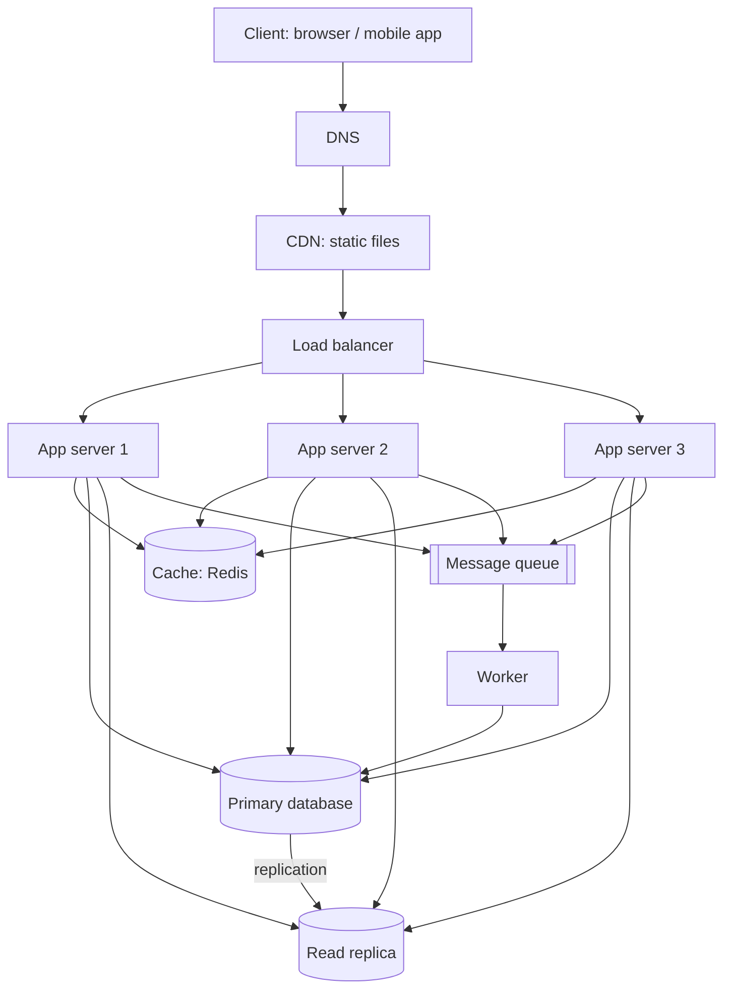

# QuickNotes Architecture

## Requirements

**Functional**
- Users register, log in and log out.
- Users create, read, update and delete their own notes.
- Users tag notes and filter notes by tag.
- Users can list their notes, newest first, with pagination.
- Optional background jobs: send notifications and build a search index after a note is saved.

**Non-functional**
- **Availability:** 99.9% uptime; no single point of failure.
- **Latency:** p95 under 300 ms for reads and under 500 ms for writes.
- **Scalability:** support 1 million users, and grow by adding servers.
- **Durability:** a saved note is never lost (replicated database, daily backups).
- **Security:** HTTPS everywhere, hashed passwords, users can only access their own notes.
- **Consistency:** a user sees their own new note immediately; other data may be a few seconds stale.

## Load estimate (1 million users)

Assumptions: 30% of users are active each day (300,000); each active user reads notes 30 times and writes (create/edit/delete) 5 times per day; an average note is about 1 KB; peak traffic is about 3x the average.

| Metric | Calculation | Result |
|--------|-------------|--------|
| Reads per day | 300,000 x 30 | 9,000,000 |
| Reads per second | 9,000,000 / 86,400 | ~104/s average, ~310/s peak |
| Writes per day | 300,000 x 5 | 1,500,000 |
| Writes per second | 1,500,000 / 86,400 | ~17/s average, ~50/s peak |
| Storage per year | 1,500,000 x 365 x 1 KB | ~550 GB (about 0.8 TB with indexes) |

The system is read-heavy (roughly 6 reads for every write), which is why a cache and read replicas pay off.

## Architecture diagram

## Why each component exists

- **Client:** the browser or mobile app that shows notes and calls the API over HTTPS.
- **DNS:** turns `quicknotes.example` into the address of the nearest entry point, so users never need an IP address and traffic can be moved during failures.
- **CDN:** serves HTML, CSS, JS and images from servers close to the user, which cuts latency and keeps static traffic off our app servers.
- **Load balancer:** spreads requests across app servers and removes unhealthy ones, so no single server is overloaded or a single point of failure.
- **App servers (3, stateless):** run the API logic; because they hold no session state, we can add or remove servers freely to scale.
- **Cache (Redis):** keeps recently read note lists in memory, so repeated reads skip the database and answer in milliseconds.
- **Primary database:** the single source of truth that accepts all writes, so data stays consistent.
- **Read replica:** a live copy of the primary that serves read queries, sharing the read load and acting as a standby if the primary fails.
- **Queue:** accepts slow or non-urgent jobs (notifications, search indexing) so the API can reply to the user immediately.
- **Worker:** takes jobs from the queue and runs them in the background, with retries, without slowing user requests.

## Request flows

### GET /notes

1. The client resolves the domain through DNS and sends `GET /v1/notes` over HTTPS with its token.
2. The load balancer picks a healthy app server.
3. The app server checks the token and finds the user id.
4. It looks for the key `notes:user:42:page1` in the cache.
5. **Cache hit:** it returns the cached JSON with `200 OK`. Done.
6. **Cache miss:** it runs the query on the **read replica**.
7. It stores the result in the cache with a short TTL (for example 60 seconds).
8. It returns the notes with `200 OK`.

### POST /notes

1. The client sends `POST /v1/notes` with the JSON note and its token.
2. The load balancer forwards it to an app server.
3. The app server authenticates the user and validates the input (title required, at most 100 characters); invalid input returns `400`.
4. It inserts the note (and its tags) into the **primary database** inside one transaction.
5. It deletes the user's cached note lists so the next read is fresh.
6. It puts a job such as `note.created` on the **queue** (notifications, search indexing).
7. It returns `201 Created` with the new note and a `Location` header.
8. A **worker** picks up the job later and processes it in the background; failures are retried.
9. The primary replicates the new row to the read replica within moments.

## Trade-offs

1. **Cache speed vs. freshness.** The cache makes reads very fast but can serve stale data for up to the TTL. We reduce the problem by deleting the user's cache entry on every write, and accept short staleness for everything else.
2. **Read replica lag (eventual consistency).** Replicas can be a fraction of a second behind the primary, so a user might not see a note they just created if the read goes to the replica. We accept this for general reads and, right after a write, read from the primary or the cache entry we just updated.
3. **SQL consistency vs. NoSQL write scaling.** One primary limits write throughput, but we need only ~50 writes/s at peak, so the simplicity and integrity of SQL win. We can shard by `user_id` later.
4. **Async queue vs. immediate processing.** The queue keeps `POST` fast but means side effects (notifications, search) happen a few seconds later and need retry and monitoring.

## Avoiding single points of failure

- **DNS and CDN:** use a managed provider with many servers worldwide.
- **Load balancer:** run two or more (active-passive or managed multi-zone) behind one DNS name.
- **App servers:** at least three stateless servers spread over different availability zones; the load balancer stops sending traffic to a failed one.
- **Cache:** Redis with a replica and automatic failover; if the cache is down, the app falls back to the database (slower but working).
- **Database:** the read replica can be promoted to primary automatically if the primary fails, plus continuous backups.
- **Queue and worker:** a replicated managed queue, several workers, and failed jobs are retried or moved to a dead-letter queue.
